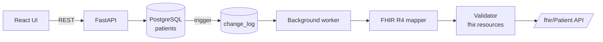

# MediBridge — clinic records to FHIR R4, automatically

Small clinics keep patient records in ordinary SQL databases. Sharing them with hospitals, labs or insurers increasingly requires **HL7 FHIR R4**, the healthcare data standard. MediBridge sits next to a clinic's existing database and turns every new or updated patient record into a validated FHIR R4 `Patient` resource, with no change to how staff register patients.

**Flow:** Register patient → PostgreSQL → trigger writes to `change_log` → background worker → FHIR R4 mapping → validation → available through a FHIR API and a web UI.

## The problem

- Clinic software stores data in its own SQL schema; other systems expect FHIR.
- Converting records by hand is slow, error-prone and never up to date.
- Small clinics can't afford enterprise integration engines.

## What it does

- **Register and edit patients** in a simple web UI (React).
- **Detects every change automatically** with PostgreSQL triggers, without touching the clinic's application code.
- **Converts each record to FHIR R4** in a background worker, usually within a few seconds.
- **Validates** every resource against the FHIR R4 structure before exposing it.
- **Serves FHIR** at `/fhir/Patient` and `/fhir/Patient/{id}`, plus a dashboard with converted / pending / failed counts and a sync monitor.

## Design decisions and trade-offs

| Decision | Why | Trade-off accepted |
| --- | --- | --- |
| Change capture with **PostgreSQL triggers + a `change_log` table** | Captures every insert and update at the database level, so the clinic's existing app needs no changes | Ties the design to PostgreSQL |
| Conversion in an **async background worker**, not in the request | Registering a patient stays fast; a mapping failure never blocks clinic staff | Records are eventually consistent (seconds, not instant) |
| Per-record sync status (converted / pending / failed) | Staff and admins can see exactly what failed and retry, instead of silent data loss | Extra state to maintain |
| Structural validation with `fhir.resources` instead of the HAPI FHIR Validator | Pure Python, no Java runtime to deploy | Checks R4 structure, not full profile and terminology rules |



## Status

A working MVP, built as a semester project. It runs locally with Docker; demo data uses fictional patients only. **Next:** map `Encounter` and `Observation` resources, and add a hosted demo.

---

## Technology Stack

| Layer | Technology |
|-------|------------|
| Frontend | React 18 + Vite + Tailwind CSS |
| Backend | Python 3.11+ + FastAPI |
| Database | PostgreSQL 15 (Docker) |
| Change Detection | PostgreSQL triggers + `change_log` table |
| FHIR Processing | Python background worker (asyncio) |
| FHIR Standard | HL7 FHIR R4 |
| Validation | `fhir.resources` Python library (R4 structural validation) |
| API Docs | FastAPI Swagger UI at `/docs` |

> **Validation note:** FHIR resources are validated using the `fhir.resources` Python package against the official FHIR R4 structural schema. This is **not** HAPI FHIR Validator validation (which requires a Java runtime).

---

## Prerequisites

- Docker Desktop (running)
- Python 3.11+
- Node.js 18+
- npm 9+

---

## Setup & Startup

### Step 1 — Start PostgreSQL

```powershell
# From the project root
docker compose up -d
```

Wait until the container is healthy:
```powershell
docker ps  # should show medibridge_postgres as healthy
```

### Step 2 — Install & start the backend

```powershell
cd backend
pip install -r requirements.txt
python -m uvicorn main:app --host 0.0.0.0 --port 8000 --reload
```

The backend starts at **http://localhost:8000**  
Swagger docs: **http://localhost:8000/docs**

### Step 3 — Seed demo data

Open a **second terminal**:

```powershell
cd backend
python seed.py
```

This inserts two fictional demo patients (P-1001: Asha Rao, P-1002: Rohan Kumar Sharma).  
The background worker will process them within ~3 seconds.

### Step 4 — Install & start the frontend

Open a **third terminal**:

```powershell
cd frontend
npm install
npm run dev
```

The frontend starts at **http://localhost:5173**

---

## Demo walkthrough

See [`demo_script.md`](./demo_script.md) for the step-by-step demonstration guide.

---

## API Endpoints

| Method | Endpoint | Description |
|--------|----------|-------------|
| GET | `/` | Health check |
| POST | `/patients` | Register a patient |
| GET | `/patients` | List patients (supports `?search=`) |
| GET | `/patients/{id}` | Get patient by patient_id |
| PUT | `/patients/{id}` | Update patient |
| GET | `/fhir/Patient` | List FHIR Bundle |
| GET | `/fhir/Patient/{id}` | Get FHIR R4 Patient resource |
| GET | `/sync/events` | Get change_log events |
| GET | `/dashboard/stats` | Get dashboard summary counts |

---

## Project Structure

```
medibridge/
├── backend\
│   ├── main.py           # FastAPI app + lifespan worker
│   ├── database.py       # asyncpg connection pool
│   ├── models.py         # Pydantic models
│   ├── fhir_mapper.py    # SQL → FHIR R4 mapper
│   ├── validator.py      # fhir.resources R4 validation
│   ├── worker.py         # Background change processor
│   ├── seed.py           # Demo data seeder
│   ├── init_db.sql       # Schema + triggers
│   └── requirements.txt
├── frontend\
│   ├── src\
│   │   ├── pages\        # Dashboard, Patients, FHIRExplorer, SyncMonitor
│   │   ├── components\   # Sidebar, StatCard, PatientForm
│   │   └── api\          # Axios client
│   └── package.json
├── docker-compose.yml
├── .env.example
└── README.md
```

---

## Stopping the Application

```powershell
# Stop Docker PostgreSQL
docker compose down

# Press Ctrl+C in the backend and frontend terminals
```

## Resetting the Database

```powershell
docker compose down -v   # removes volume — clears all data
docker compose up -d     # re-creates with fresh schema
```
